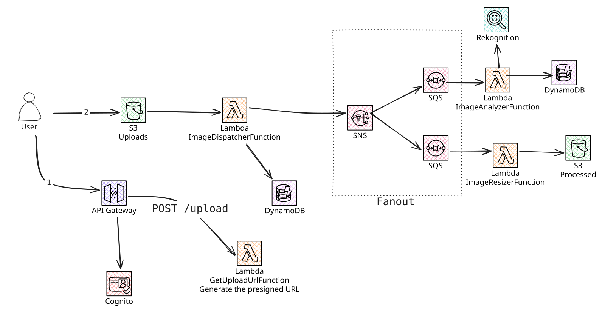

# Darkroom: an Event-Driven Image Pipeline on AWS with SNS Fan-Out


A serverless image pipeline on AWS, built with SAM and TypeScript: an upload fans out through SNS and SQS to independent consumers, one tagging images with Rekognition and one making WebP copies with sharp, with DLQs, alarms and idempotent writes.

Darkroom was called _media-processor_ through V1 to V5. The old architecture diagrams are kept in [images/](images/) under their original names. The plan behind V6 and the evidence for each step is in [PLANNING.md](PLANNING.md).

This is one of my sample AWS serverless projects, built to strengthen my skills on AWS.

Below is the overall overview of the project architecture. We will explain each part in detail later.



## Table of contents

- [Architecture](#architecture)
  - [High-level architecture](#high-level-architecture)
  - [1. Auth and API](#1-auth-and-api)
  - [2. Upload](#2-upload)
  - [3. The dispatcher](#3-the-dispatcher)
  - [4. Fan-out: SNS and SQS](#4-fan-out-sns-and-sqs)
  - [5. The analyzer](#5-the-analyzer)
  - [6. The resizer](#6-the-resizer)
  - [7. What the consumers share](#7-what-the-consumers-share)
  - [8. Failures, alarms and logs](#8-failures-alarms-and-logs)
  - [Key decisions](#key-decisions)
- [The item in DynamoDB](#the-item-in-dynamodb)
- [API reference](#api-reference)
- [Getting Started](#getting-started)
- [Tests](#tests)
- [Local Development](#local-development)
- [Cost](#cost)
- [Next ideas](#next-ideas)
- [Clean Up](#clean-up)

## Architecture

### High-level architecture

The system has two halves, split by an S3 event:

- **Upload (synchronous).** A signed-in user calls `POST /upload` on API Gateway, which checks the Cognito token. A Lambda validates the request and returns a presigned S3 URL. The user then uploads the image straight to S3, so the bytes never pass through API Gateway or Lambda.
- **Processing (asynchronous).** S3 invokes a dispatcher Lambda for each new object. It saves the item to DynamoDB and publishes one message to SNS. SNS fans the message out to one SQS queue per consumer. The analyzer tags the image with Rekognition, and the resizer makes WebP copies with `sharp` in a separate bucket. Each consumer has its own queue, dead-letter queue (DLQ) and alarm, and writes only its own part of the item.

Each part is explained below, with the code that does the work. Everything is declared in [template.yaml](template.yaml), and the handlers are in [functions/src/](functions/src/).

| Part | Resource | Code |
| ---- | -------- | ---- |
| Sign-in | Cognito user pool and app client | `template.yaml` |
| API | HTTP API with a JWT authorizer | `template.yaml` |
| Upload URL | `GetUploadUrlFunction` | `get-upload-url.ts` |
| Dispatcher | `ImageDispatcherFunction` | `image-dispatcher.ts` |
| Fan-out | `ImageEventsTopic`, one queue and DLQ per consumer | `template.yaml` |
| Analyzer | `ImageAnalyzerFunction` | `image-analyzer.ts` |
| Resizer | `ImageResizerFunction` and the `sharp` layer | `image-resizer.ts` |
| Shared | Partial batch responses, item writes | `sqs-batch.ts`, `item-store.ts` |

### 1. Auth and API

Amazon Cognito handles sign-in and issues the JWT. API Gateway's built-in JWT authorizer verifies it, so a request with a bad token is rejected before any Lambda runs:

```yaml
# template.yaml
DarkroomApi:
  Type: AWS::Serverless::HttpApi
  Properties:
    Auth:
      Authorizers:
        CognitoJwtAuthorizer:
          IdentitySource: $request.header.Authorization
          JwtConfiguration:
            Issuer: !Sub "https://cognito-idp.${AWS::Region}.amazonaws.com/${AuthCognitoUserPool}"
            Audience:
              - !Ref AuthCognitoUserPoolClient
      DefaultAuthorizer: CognitoJwtAuthorizer
```

- There is one route, `POST /upload`, and every route is protected by default.
- The handler takes the caller's identity only from the verified token (the `sub` claim), never from the request body.
- The app client allows `USER_PASSWORD_AUTH`, which is what the `try-it.sh` script and the walkthrough use to get a token. It is a development convenience.

### 2. Upload

`GetUploadUrlFunction` validates the request and signs a `PUT` URL for a key it chooses itself. It can only write to the upload bucket (`S3WritePolicy`).

```ts
// functions/src/get-upload-url.ts

// Rekognition only reads JPEG and PNG, so nothing else is accepted.
const ALLOWED_TYPES = {
    'image/jpeg': { extension: 'jpg', filenameExtensions: ['jpg', 'jpeg'] },
    'image/png': { extension: 'png', filenameExtensions: ['png'] },
};
const MAX_SIZE_BYTES = 10 * 1024 * 1024;

// The filename is only validated, never used: the key comes from the user and a random id.
const key = `uploads/${userId}/${randomUUID()}.${allowed.extension}`;

// Signing both headers means S3 rejects a PUT whose type or length differs from what was declared.
// content-type is not signed unless it is listed here.
const uploadUrl = await getSignedUrl(s3Client, command, {
    expiresIn: URL_EXPIRY_SECONDS,
    signableHeaders: new Set(['content-type', 'content-length']),
});
```

- Keys have the form `uploads/{userId}/{uuid}.{ext}`, so two users uploading `photo.jpg` never overwrite each other.
- A bad body, type, extension or size is a `400` that says which check failed, never a `500`. The checks run before anything is signed.
- The URL expires after 5 minutes. The full request and response contract is in the [API reference](#api-reference).

### 3. The dispatcher

S3 invokes `ImageDispatcherFunction` for every new object under `uploads/`. The prefix filter matters: it is one of the two things that stop the pipeline from triggering itself (the other is the separate processed bucket, see section 6).

```yaml
# template.yaml
Events:
  NewFileEvent:
    Type: S3
    Properties:
      Bucket: !Ref UploadBucket
      Events: s3:ObjectCreated:*
      Filter:
        S3Key:
          Rules:
            - Name: prefix
              Value: uploads/
```

The dispatcher does two things: record the upload, then announce it. It starts both consumers as `PENDING`, and the write is conditional so a duplicate S3 event can never reset finished work:

```ts
// functions/src/image-dispatcher.ts
await ddbDocClient.send(
    new PutCommand({
        TableName: tableName,
        Item: {
            id: fileKey,
            bucket: bucketName,
            size: record.s3.object.size,
            createdAt: new Date().toISOString(),
            analysis: { status: 'PENDING' },
            resize: { status: 'PENDING' },
        },
        ConditionExpression: 'attribute_not_exists(id)',
    }),
);
```

If the condition fails, the item already exists. That is either a duplicate event, or a retry after a failed publish. The dispatcher reads the item back and publishes again only while a consumer is still `PENDING`. Without that check, a retry after a failed publish would see "already exists" and the event would be lost.

- It does not catch errors. A failure fails the invocation, so S3 retries it.
- Its IAM is narrow: `PutItem` and `GetItem` on the table, and publish on the topic. It never reads S3.

### 4. Fan-out: SNS and SQS

The dispatcher publishes each upload to one SNS topic. Every consumer gets its own queue, subscribed to that topic. Here is the analyzer's; the resizer's is identical apart from the names:

```yaml
# template.yaml
AnalyzerQueue:
  Type: AWS::SQS::Queue
  Properties:
    # 6x the analyzer's timeout (30 s), so a message isn't handed to a second invocation
    # while the first may still be working on it.
    VisibilityTimeout: 180
    RedrivePolicy:
      deadLetterTargetArn: !GetAtt AnalyzerDeadLetterQueue.Arn
      maxReceiveCount: 3

# Only this topic may send to this queue.
AnalyzerQueuePolicy:
  Type: AWS::SQS::QueuePolicy
  Properties:
    Queues:
      - !Ref AnalyzerQueue
    PolicyDocument:
      Version: '2012-10-17'
      Statement:
        - Effect: Allow
          Principal:
            Service: sns.amazonaws.com
          Action: sqs:SendMessage
          Resource: !GetAtt AnalyzerQueue.Arn
          Condition:
            ArnEquals:
              aws:SourceArn: !Ref ImageEventsTopic

AnalyzerSubscription:
  Type: AWS::SNS::Subscription
  Properties:
    TopicArn: !Ref ImageEventsTopic
    Protocol: sqs
    Endpoint: !GetAtt AnalyzerQueue.Arn
    RawMessageDelivery: true
    FilterPolicy:
      eventType:
        - ObjectCreated
```

- **A new consumer is a new queue, subscription and function.** Nothing in the dispatcher, the topic or the other consumers changes.
- **Raw message delivery** means a consumer reads the dispatcher's `{ bucket, key }` JSON directly, with no SNS envelope.
- **The filter policy** matches the `eventType` attribute the dispatcher sets on every message.
- **The queue policy** lets only this topic send to this queue.
- **The DLQ** keeps messages for 14 days, the maximum, so a failure can be looked at later.

### 5. The analyzer

`ImageAnalyzerFunction` reads its queue in batches of 5, with at most 5 concurrent invocations. It asks Rekognition for up to five labels (70% confidence or higher) and writes them to the `analysis` attribute:

```ts
// functions/src/image-analyzer.ts
try {
    const rekogResponse = await rekogClient.send(
        new DetectLabelsCommand({
            Image: { S3Object: { Bucket: bucket, Name: key } },
            MaxLabels: 5,
            MinConfidence: 70,
        }),
    );
    labels = rekogResponse.Labels?.map((label) => label.Name) || [];
} catch (error) {
    if (error instanceof InvalidImageFormatException || error instanceof ImageTooLargeException) {
        await saveItemAttribute(key, 'analysis', { status: 'FAILED', error: error.name });
        return;
    }
    throw error;
}

await saveItemAttribute(key, 'analysis', { status: 'COMPLETE', labels });
```

The `try`/`catch` encodes the main rule of this project: **retrying cannot fix a file that can never be processed.** An image Rekognition can never read is recorded as `FAILED` and not retried. Any other error is rethrown, so the message is retried and, after 3 attempts, lands in the DLQ.

Its IAM is read-only on the upload bucket, Rekognition detect-only, and `dynamodb:UpdateItem` on the table.

### 6. The resizer

`ImageResizerFunction` makes two WebP copies of each image, a `thumb` (256 px) and a `medium` (1024 px), and writes them to the **processed bucket**.

```ts
// functions/src/image-resizer.ts
const VARIANTS = [
    { name: 'thumb', size: 256 },
    { name: 'medium', size: 1024 },
] as const;

// Refuses decompression bombs: a small file can describe a huge image. 50 megapixels is a large photo.
const MAX_INPUT_PIXELS = 50_000_000;

// uploads/{userId}/{id}.jpg -> {userId}/{id}_thumb.webp
const processedKey = (uploadKey: string, variant: string): string =>
    `${uploadKey.replace(/^uploads\//, '').replace(/\.[^./]+$/, '')}_${variant}.webp`;

const render = (original: Buffer, size: number): Promise<Buffer> =>
    sharp(original, { limitInputPixels: MAX_INPUT_PIXELS })
        .rotate() // apply the EXIF orientation, so phone photos aren't sideways
        .resize({ width: size, height: size, fit: 'inside', withoutEnlargement: true })
        .webp({ quality: 80 })
        .toBuffer();
```

- **Fit inside the box, keep the aspect ratio, never upscale.** A 3000×2000 image gives 256×171 and 1024×683, and a 100×50 image stays 100×50.
- **A separate bucket.** A file written into the upload bucket would trigger the dispatcher again and loop. The processed bucket blocks all public access.
- **`sharp` is a Lambda layer.** It is native code, so esbuild cannot bundle it, and SAM does not package externals. The layer's `.npmrc` sets `os=linux`, `cpu=arm64` and `libc=glibc`, so `npm install` fetches the Linux arm64 binaries even on a Mac. No Docker is needed.

```yaml
# template.yaml
SharpLayer:
  Type: AWS::Serverless::LayerVersion
  Properties:
    ContentUri: layers/sharp/
    CompatibleRuntimes:
      - nodejs20.x
    CompatibleArchitectures:
      - arm64
  Metadata:
    BuildMethod: nodejs20.x
    BuildArchitecture: arm64
```

- **1024 MB, a 60 s timeout and a batch size of 1**, because resizing is memory-heavy. The queue's visibility timeout is 360 s, 6× the timeout.
- **Uploading overwrites**, so a retry after a partial failure is safe.
- **Least privilege:** read on the upload bucket, `s3:PutObject` on the processed bucket only, and `dynamodb:UpdateItem`.
- Like the analyzer, a file `sharp` can never read (corrupt, or over 50 megapixels) is recorded as `resize.status = FAILED` and not retried. Only the decoding step is treated that way: a failure in S3 or DynamoDB is transient and is retried.

### 7. What the consumers share

Both consumers use two small helpers, so a new consumer needs very little code.

**Partial batch responses.** One bad record is returned to the queue on its own, and the rest of the batch does not run again:

```ts
// functions/src/sqs-batch.ts
for (const record of event.Records) {
    try {
        await processRecord(record);
    } catch (error) {
        console.error(`Record ${record.messageId} failed, returning it to the queue:`, error);
        batchItemFailures.push({ itemIdentifier: record.messageId });
    }
}
return { batchItemFailures };
```

This needs `ReportBatchItemFailures` on the event source mapping, which the template sets for both consumers.

**One attribute per consumer.** Each consumer writes only its own attribute, and only if the item exists:

```ts
// functions/src/item-store.ts
export type ConsumerAttribute = 'analysis' | 'resize';

await ddbDocClient.send(
    new UpdateCommand({
        TableName: tableName,
        Key: { id: key },
        UpdateExpression: `SET ${attribute} = :a`,
        ConditionExpression: 'attribute_exists(id)',
        ExpressionAttributeValues: { ':a': { ...value, at: new Date().toISOString() } },
    }),
);
```

The condition keeps a consumer from creating an item the dispatcher never wrote. A missing item fails the invocation, and the message is retried. The shape of the item is described in [The item in DynamoDB](#the-item-in-dynamodb).

### 8. Failures, alarms and logs

A failure must be visible and retryable, never disguised as success. Here is how that works end to end:

1. A handler never swallows an error. It throws, so the message is retried instead of being reported as success.
2. After 3 failed attempts (`maxReceiveCount: 3`) the message moves to the consumer's DLQ.
3. A CloudWatch alarm on the DLQ goes to `ALARM` as soon as one message is visible:

```yaml
# template.yaml
AnalyzerDeadLetterQueueAlarm:
  Type: AWS::CloudWatch::Alarm
  Properties:
    AlarmDescription: A message gave up in the analyzer queue and is waiting in its DLQ
    Namespace: AWS/SQS
    MetricName: ApproximateNumberOfMessagesVisible
    Dimensions:
      - Name: QueueName
        Value: !GetAtt AnalyzerDeadLetterQueue.QueueName
    Statistic: Maximum
    Period: 60
    EvaluationPeriods: 1
    Threshold: 0
    ComparisonOperator: GreaterThanThreshold
    TreatMissingData: notBreaching
```

- The alarms only change state. They do not notify anyone yet, which is a next step (see [Next ideas](#next-ideas)).
- Each function has its own log group with 14 days of retention, set by the `LogRetentionDays` parameter, so logs do not pile up forever.
- No bucket, topic or queue name is hardcoded. CloudFormation generates them, so a second stack under another name does not collide.

### Key decisions

| Decision | Why | Trade-off |
| -------- | --- | --------- |
| Presigned URL, not upload through the API | The image bytes never pass through API Gateway or Lambda | The client makes two calls |
| Server-chosen key with the user's `sub` | Users cannot overwrite each other, and the filename is never trusted | The original filename is not kept in the key |
| SNS fan-out to one SQS queue per consumer | Each consumer has its own retries, DLQ and alarm, and a new consumer changes nothing else | More resources to declare for each consumer |
| One attribute per consumer on a single item | Consumers never overwrite each other, and the item shows each step's status | Reading the result means reading the whole item |
| Conditional writes (`attribute_not_exists`, `attribute_exists`) | Duplicate events and retries are harmless | A missing item is an error that is retried |
| `FAILED` for files that can never be processed | Retrying cannot help, so the DLQ stays for real incidents | A bad image is recorded, not alarmed on |
| A separate processed bucket and a prefix filter | The resizer's output can never trigger the pipeline again | Two buckets to empty before `sam delete` |
| `sharp` as a Linux arm64 layer | Native code works without Docker | The layer is built separately from the functions |
| SimpleTable (on-demand) for DynamoDB | Access is by key only, and an idle table costs nothing | No secondary indexes, so there is no way to list a user's images yet |

## The item in DynamoDB

Each consumer owns one attribute and writes nothing else, so consumers never overwrite each other. Both start as `PENDING`.

```json
{
  "id": "uploads/<userId>/<uuid>.jpg",
  "bucket": "darkroom-uploadbucket-...",
  "size": 123456,
  "createdAt": "2026-11-12T10:00:00.000Z",
  "analysis": { "status": "COMPLETE", "labels": ["Dog", "Grass"], "at": "..." },
  "resize": {
    "status": "COMPLETE",
    "variants": ["<userId>/<uuid>_thumb.webp", "<userId>/<uuid>_medium.webp"],
    "at": "..."
  }
}
```

| `status`   | Meaning                                                                                                                  |
| ---------- | ------------------------------------------------------------------------------------------------------------------------ |
| `PENDING`  | The consumer hasn't finished yet.                                                                                        |
| `COMPLETE` | Done. `analysis` has `labels`, `resize` has `variants` (keys in the processed bucket).                                   |
| `FAILED`   | The file can never be processed (not an image, or over the limits), so it was recorded instead of retried. See `error`. |

A transient failure (S3, DynamoDB, throttling) is not recorded. The message is retried, and after 3 attempts it lands in the DLQ.

## API reference

Darkroom has one HTTP route, behind API Gateway. The upload itself goes straight to S3 with the URL that route returns, and the token comes from Cognito. All three calls are listed here, in the order a client makes them. Base URL: the `ApiUrl` stack output.

| # | Call | Method and path | Auth | Request | Success |
| - | ---- | --------------- | ---- | ------- | ------- |
| 1 | Get a token | Cognito `InitiateAuth` (`USER_PASSWORD_AUTH`), with the stack's `UserPoolClientId` | Username and password | `USERNAME`, `PASSWORD` | `AuthenticationResult.IdToken` (valid for an hour) |
| 2 | Get an upload URL | `POST /upload` | `Authorization: Bearer <IdToken>` | JSON body (below) | `200` with `uploadUrl`, `key`, `message` |
| 3 | Upload the image | `PUT <uploadUrl>` (S3, not API Gateway) | The signature in the URL | The raw image bytes | `200`, empty body |

### `POST /upload`

Request headers:

| Header | Value |
| ------ | ----- |
| `Authorization` | `Bearer <IdToken>` |
| `Content-Type` | `application/json` |

Request body:

| Field | Type | Required | Rule |
| ----- | ---- | -------- | ---- |
| `filename` | string | yes | Not empty. The extension must match `contentType` (`jpg` or `jpeg` for JPEG, `png` for PNG). Only validated, never used in the key |
| `contentType` | string | yes | `image/jpeg` or `image/png` (the types Rekognition reads) |
| `size` | integer | yes | The file size in bytes, from 1 to 10485760 (10 MB) |

```json
{ "filename": "photo.jpg", "contentType": "image/jpeg", "size": 123456 }
```

Responses:

| Status | When | Body |
| ------ | ---- | ---- |
| `200` | The request is valid | `{ "uploadUrl", "key", "message" }` |
| `400` | The body is not valid JSON or not an object, `filename` is missing or its extension does not match, `contentType` is not allowed, or `size` is out of range | `{ "message": "..." }`, naming the check that failed |
| `401` | No valid token (API Gateway), or the token has no `sub` claim (the function) | `{ "message": "..." }` |
| `500` | The URL could not be signed | `{ "message": "Could not generate upload URL" }` |

A `200` looks like this:

```json
{
  "uploadUrl": "https://<bucket>.s3.amazonaws.com/uploads/<sub>/<uuid>.jpg?X-Amz-...",
  "key": "uploads/<sub>/<uuid>.jpg",
  "message": "Use a PUT request with the same Content-Type and body size to upload your file to the uploadUrl"
}
```

| Field | Meaning |
| ----- | ------- |
| `uploadUrl` | A presigned `PUT` URL. It expires after 5 minutes |
| `key` | The S3 key the server chose, `uploads/{sub}/{uuid}.{ext}`. It is also the `id` of the item in DynamoDB |

### `PUT <uploadUrl>`

| Header | Value |
| ------ | ----- |
| `Content-Type` | Exactly the `contentType` you declared |
| `Content-Length` | Exactly the `size` you declared (set by the client from the body) |

| Status | When |
| ------ | ---- |
| `200` | The upload succeeded. The pipeline starts from this upload, so there is no further call to make |
| `403` | The `Content-Type` or length differs from what was signed, or the URL has expired |

There is no read endpoint yet. Check the result in the DynamoDB item and the processed bucket (see [The item in DynamoDB](#the-item-in-dynamodb) and [Getting Started](#getting-started)).

CORS allows `POST`, `GET` and `OPTIONS` with the `Authorization` and `Content-Type` headers on the API, and `GET`, `PUT`, `POST` and `HEAD` on the upload bucket.

## Getting Started

You need the AWS CLI with credentials that can create the stack, the SAM CLI and Node.js 20 or later. Docker is not needed. Click a step to expand it.

<details>
<summary><b>1. Build and deploy</b></summary>

```bash
cd functions && npm install && cd ..
sam validate --lint
sam build
sam deploy            # settings come from samconfig.toml; add --guided to review them
```

The first deploy creates the stack `darkroom` in `us-east-1`. Bucket, topic and queue names are generated, so a second stack under another name doesn't collide. The stack outputs the API URL, the Cognito pool and client IDs, both bucket names, the table name and both DLQ URLs.

</details>

<details>
<summary><b>2. Try it with the script</b></summary>

The script signs in (creating a demo user on the first run), uploads the image, waits for both consumers, prints the result and checks the failure cases:

```bash
DARKROOM_PASSWORD='YOUR-PASSWORD' scripts/try-it.sh path/to/photo.jpg
```

It needs `curl` and `jq`, and prompts for the password if the variable isn't set. Pass `--no-failure-cases` to skip the rejection checks, and see `--help` for `STACK`, `AWS_REGION` and `DARKROOM_USER`.

</details>

<details>
<summary><b>3. Try it by hand with curl</b></summary>

Read the stack outputs into variables:

```bash
STACK=darkroom; REGION=us-east-1
out() { aws cloudformation describe-stacks --region $REGION --stack-name $STACK \
  --query "Stacks[0].Outputs[?OutputKey=='$1'].OutputValue" --output text; }

API=$(out ApiUrl); CLIENT_ID=$(out UserPoolClientId); POOL_ID=$(out UserPoolId)
PROCESSED=$(out ProcessedBucketName); TABLE=$(out TableName)
```

Create a user and sign in. The password must meet the pool's policy (at least 8 characters, and Cognito's defaults also require mixed case, a number and a symbol). The token expires after an hour.

```bash
aws cognito-idp admin-create-user --region $REGION --user-pool-id $POOL_ID \
  --username you@example.com --message-action SUPPRESS
aws cognito-idp admin-set-user-password --region $REGION --user-pool-id $POOL_ID \
  --username you@example.com --password 'YOUR-PASSWORD' --permanent

TOKEN=$(aws cognito-idp initiate-auth --region $REGION --client-id $CLIENT_ID \
  --auth-flow USER_PASSWORD_AUTH \
  --auth-parameters USERNAME=you@example.com,PASSWORD='YOUR-PASSWORD' \
  --query 'AuthenticationResult.IdToken' --output text)
```

Ask for an upload URL, then upload the file with the same content type and size you declared:

```bash
FILE=photo.jpg
SIZE=$(wc -c < "$FILE" | tr -d ' ')

RESP=$(curl -s -X POST "$API/upload" \
  -H "Authorization: Bearer $TOKEN" -H "Content-Type: application/json" \
  -d "{\"filename\":\"$FILE\",\"contentType\":\"image/jpeg\",\"size\":$SIZE}")
UPLOAD_URL=$(echo "$RESP" | jq -r .uploadUrl); KEY=$(echo "$RESP" | jq -r .key)

curl -i -X PUT "$UPLOAD_URL" -H "Content-Type: image/jpeg" --data-binary @"$FILE"
```

There is no read endpoint yet, so a few seconds later look at the item and the copies directly:

```bash
aws dynamodb get-item --region $REGION --table-name $TABLE --key "{\"id\":{\"S\":\"$KEY\"}}"
aws s3 ls "s3://$PROCESSED/" --recursive
```

**Failure cases** (see the [API reference](#api-reference) for the responses):

```bash
# 401: no token (the authorizer answers before the Lambda runs)
curl -i -X POST "$API/upload" -H "Content-Type: application/json" \
  -d '{"filename":"photo.jpg","contentType":"image/jpeg","size":1000}'

# 400: type not allowed (only image/jpeg and image/png)
curl -i -X POST "$API/upload" -H "Authorization: Bearer $TOKEN" -H "Content-Type: application/json" \
  -d '{"filename":"doc.pdf","contentType":"application/pdf","size":1000}'

# 400: extension does not match the type
curl -i -X POST "$API/upload" -H "Authorization: Bearer $TOKEN" -H "Content-Type: application/json" \
  -d '{"filename":"photo.png","contentType":"image/jpeg","size":1000}'

# 400: larger than 10 MB
curl -i -X POST "$API/upload" -H "Authorization: Bearer $TOKEN" -H "Content-Type: application/json" \
  -d '{"filename":"photo.jpg","contentType":"image/jpeg","size":20000000}'

# 403 from S3: the PUT differs from what was declared (here, the content type)
curl -i -X PUT "$UPLOAD_URL" -H "Content-Type: image/png" --data-binary @"$FILE"
```

</details>

## Tests

<details>
<summary><b>Unit tests</b>: mocked AWS clients, nothing deployed</summary>

The resizer tests run real `sharp`.

```bash
cd functions
npm test             # compile + unit tests
npm run lint         # ESLint, which also enforces Prettier
npm run format       # format src/ and tests/ with Prettier
npm run format:check # the same check without writing
```

</details>

<details>
<summary><b>Live tests</b>: against the deployed stack</summary>

Most of this project is events and queues rather than HTTP, so the live tests assert on S3, DynamoDB, SQS and CloudWatch directly. They look every resource up from the stack (`STACK_NAME`, default `darkroom`) and clean up after themselves.

```bash
cd functions
npm run test:live       # about 1 minute: upload API, S3 limits, upload -> labels and resized copies, duplicates, FAILED, independence, prefix filter
npm run test:live:dlq   # about 25 minutes: a poison message reaches each consumer's DLQ and raises its alarm
```

They call the upload Lambda directly with a synthetic identity instead of signing in, so no Cognito user is needed. Set `LIVE_TEST_IMAGE=/path/to/photo.jpg` to use your own photo and get real labels. Each run costs a few cents at most.

</details>

## Local Development

<details>
<summary><b>Run the pipeline from your machine</b></summary>

The quickest loop is the unit tests, then dropping a real image into the upload bucket and watching the pipeline run:

```bash
aws s3 cp photo.jpg "s3://$(aws cloudformation describe-stacks --stack-name darkroom \
  --query "Stacks[0].Outputs[?OutputKey=='BucketName'].OutputValue" --output text)/uploads/dev/photo.jpg"
```

`sam local invoke` also works (it needs Docker), but the dispatcher it runs writes to the **real** table and publishes a **real** message. Point the event at an object that exists, or the analyzer and resizer will retry it and it will end up in the DLQs:

```bash
cp env.example.json env.json        # fill in TABLE_NAME and TOPIC_ARN from your stack
sam local invoke ImageDispatcherFunction -e events/s3-event.json --env-vars env.json
```

</details>

## Cost

Everything is pay-per-use, so an idle stack costs almost nothing. The fixed costs are S3 storage and two CloudWatch alarms. Each upload costs one Rekognition call, three Lambda invocations (plus one for the upload URL) and a few cents' worth of requests at most. Check current prices before relying on this.

## Next ideas

- A `GET /images/{id}` endpoint returning the item with short-lived URLs for the copies.
- A content-moderation consumer (Rekognition `DetectModerationLabels`).
- Notifications on the DLQ alarms (email or chat).
- Captions and semantic search with Amazon Bedrock.
- A small frontend, CI/CD, and a dev/prod split.

## Clean Up

<details>
<summary><b>Remove everything this project created</b></summary>

Empty both buckets first, because S3 won't delete a bucket that has objects, then delete the stack:

```bash
aws s3 rm "s3://UPLOAD_BUCKET" --recursive
aws s3 rm "s3://PROCESSED_BUCKET" --recursive
sam delete --stack-name darkroom
```

Both bucket names are stack outputs (`BucketName` and `ProcessedBucketName`).

</details>
