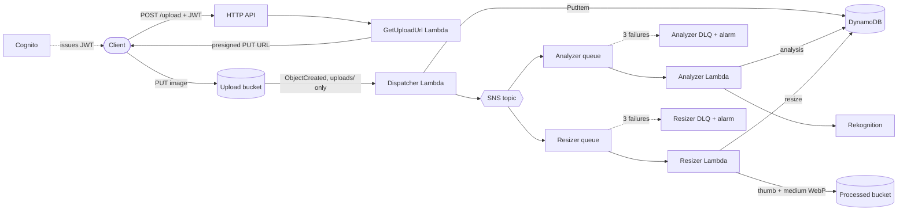

# Darkroom

> A serverless, event-driven image pipeline on AWS: S3 → SNS fan-out → SQS → Lambda → Rekognition & DynamoDB, built with SAM and TypeScript.

A signed-in user uploads a JPEG or PNG. Darkroom records it, tags it with Amazon Rekognition, and makes a thumbnail and a medium-sized copy. Each of those steps is an independent consumer of the same upload event, so a new step (a safety check, a watermark) is a new queue and a new function, and nothing existing changes.

Darkroom was called _media-processor_ through V1 to V5. The old architecture diagrams are kept in [images/](images/) under their original names. The plan behind V6 and the evidence for each step is in [PLANNING.md](PLANNING.md).

## Architecture



1.  **Amazon Cognito (User Pool + App Client)**: Handles sign-in and issues the JWT that the API checks.
2.  **API Gateway (HTTP API)**: One route, `POST /upload`, protected by a JWT authorizer. It returns an **S3 presigned URL** (see [The upload API](#the-upload-api)).
3.  **Upload bucket**: Receives the image straight from the client, so the bytes never pass through Lambda or API Gateway.
4.  **Dispatcher Lambda**: Triggered by S3 `ObjectCreated` for keys under `uploads/`. It writes the item to DynamoDB, with each consumer's part set to `PENDING`, and publishes one message to SNS.
5.  **Amazon SNS and SQS**: The topic fans the message out to one queue per consumer. A message that fails 3 times moves to that consumer's dead-letter queue (DLQ), and a CloudWatch alarm fires.
6.  **Analyzer Lambda**: Reads its queue in batches, calls **Rekognition** for up to five labels, and updates the `analysis` part of the item.
7.  **Resizer Lambda**: Reads its own queue, makes a `thumb` (256 px) and a `medium` (1024 px) WebP copy with `sharp` (shipped as a Lambda layer), writes them to a separate **Processed bucket**, and updates the `resize` part of the item. The copies go to another bucket so they can never trigger the pipeline again.
8.  **Amazon DynamoDB**: One item per upload, keyed by the S3 key.

## The item in DynamoDB

Each consumer owns one attribute and writes nothing else, so consumers never overwrite each other. Both start as `PENDING`.

```json
{
  "id": "uploads/<userId>/<uuid>.jpg",
  "bucket": "darkroom-uploadbucket-...",
  "size": 123456,
  "createdAt": "2026-11-12T10:00:00.000Z",
  "analysis": { "status": "COMPLETE", "labels": ["Dog", "Grass"], "at": "..." },
  "resize": {
    "status": "COMPLETE",
    "variants": ["<userId>/<uuid>_thumb.webp", "<userId>/<uuid>_medium.webp"],
    "at": "..."
  }
}
```

| `status`   | Meaning                                                                                                                  |
| ---------- | ------------------------------------------------------------------------------------------------------------------------ |
| `PENDING`  | The consumer hasn't finished yet.                                                                                        |
| `COMPLETE` | Done. `analysis` has `labels`, `resize` has `variants` (keys in the processed bucket).                                   |
| `FAILED`   | The file can never be processed (not an image, or over the limits), so it was recorded instead of retried. See `error`. |

A transient failure (S3, DynamoDB, throttling) is not recorded. The message is retried, and after 3 attempts it lands in the DLQ.

## The upload API

`POST /upload` with `Authorization: Bearer <JWT>`:

```json
{ "filename": "photo.jpg", "contentType": "image/jpeg", "size": 123456 }
```

- Only `image/jpeg` and `image/png` up to 10 MB are accepted, and the extension of `filename` must match the type.
- The server chooses the key, `uploads/{userId}/{uuid}.{ext}`, from the JWT's `sub`. The filename is only validated, never used, so users can't overwrite each other.
- The URL signs both `Content-Type` and `Content-Length`, so S3 rejects an upload that differs from what was declared. It expires after 5 minutes.

| Status | When                                                           |
| ------ | -------------------------------------------------------------- |
| `200`  | `{ "uploadUrl", "key", "message" }`                            |
| `400`  | Invalid body, type, extension or size (the message says which) |
| `401`  | No valid token                                                 |

## Get a token and upload an image

This walkthrough needs the AWS CLI, `curl` and `jq`. It creates a user directly in the pool, which is fine for development.

```bash
STACK=darkroom; REGION=us-east-1
out() { aws cloudformation describe-stacks --region $REGION --stack-name $STACK \
  --query "Stacks[0].Outputs[?OutputKey=='$1'].OutputValue" --output text; }

API=$(out ApiUrl); CLIENT_ID=$(out UserPoolClientId); POOL_ID=$(out UserPoolId)
PROCESSED=$(out ProcessedBucketName); TABLE=$(out TableName)
```

Create a user and sign in. Use a password that meets the pool's policy (Cognito's defaults also require mixed case, a number and a symbol).

```bash
aws cognito-idp admin-create-user --region $REGION --user-pool-id $POOL_ID \
  --username you@example.com --message-action SUPPRESS
aws cognito-idp admin-set-user-password --region $REGION --user-pool-id $POOL_ID \
  --username you@example.com --password 'YOUR-PASSWORD' --permanent

TOKEN=$(aws cognito-idp initiate-auth --region $REGION --client-id $CLIENT_ID \
  --auth-flow USER_PASSWORD_AUTH \
  --auth-parameters USERNAME=you@example.com,PASSWORD='YOUR-PASSWORD' \
  --query 'AuthenticationResult.IdToken' --output text)
```

Ask for an upload URL, then upload the file with the same content type and size you declared:

```bash
FILE=photo.jpg
SIZE=$(wc -c < "$FILE" | tr -d ' ')

RESP=$(curl -s -X POST "$API/upload" \
  -H "Authorization: Bearer $TOKEN" -H "Content-Type: application/json" \
  -d "{\"filename\":\"$FILE\",\"contentType\":\"image/jpeg\",\"size\":$SIZE}")
UPLOAD_URL=$(echo "$RESP" | jq -r .uploadUrl); KEY=$(echo "$RESP" | jq -r .key)

curl -X PUT "$UPLOAD_URL" -H "Content-Type: image/jpeg" --data-binary @"$FILE"
```

A few seconds later the item is complete and the copies exist:

```bash
aws dynamodb get-item --region $REGION --table-name $TABLE --key "{\"id\":{\"S\":\"$KEY\"}}"
aws s3 ls "s3://$PROCESSED/" --recursive
```

## Project Structure

```
.
├── functions/                  # Lambda functions (one package, bundled per function by SAM)
│   ├── src/
│   │   ├── get-upload-url.ts   # Validate the request, return a presigned URL
│   │   ├── image-dispatcher.ts # Write the item, publish the upload event
│   │   ├── image-analyzer.ts   # Rekognition labels
│   │   ├── image-resizer.ts    # Thumb and medium copies
│   │   ├── item-store.ts       # Each consumer writes only its own attribute of the item
│   │   └── sqs-batch.ts        # Partial batch responses
│   ├── tests/
│   │   ├── unit/               # Unit tests (aws-sdk-client-mock, real sharp)
│   │   └── live/               # Tests against the deployed stack
│   └── package.json            # Dependencies (AWS SDK v3) and scripts
├── layers/sharp/               # sharp for Linux arm64, shipped as a Lambda layer
├── events/s3-event.json        # Sample S3 event for sam local invoke
├── images/                     # Architecture diagrams from V1 to V5
├── template.yaml               # SAM template (infrastructure as code)
├── samconfig.toml              # Stack name (darkroom), region, deploy settings
├── env.example.json            # Template for env.json (local environment variables, git-ignored)
└── PLANNING.md                 # The V6 plan, decisions and evidence
```

## Prerequisites

- AWS CLI with credentials that can create the stack's resources (Lambda, IAM roles, S3, SQS, SNS, DynamoDB, Cognito, API Gateway, CloudWatch).
- SAM CLI.
- Node.js 20 or later (the functions run on `nodejs20.x`). esbuild is a project dependency, so nothing needs to be installed globally.
- Docker is not needed to build or deploy. `sharp` is installed for Linux arm64 by the layer's `.npmrc`, even on a Mac. Docker is only needed for `sam local invoke`.

## Getting Started

### 1. Install, build and deploy

```bash
cd functions && npm install && cd ..
sam validate --lint
sam build
sam deploy            # settings come from samconfig.toml; add --guided to review them
```

The first deploy creates the stack `darkroom` in `us-east-1`. Bucket, topic and queue names are generated, so a second stack under another name doesn't collide. The stack outputs the API URL, the Cognito pool and client IDs, both bucket names, the table name and both DLQ URLs (read them as in the walkthrough above).

### 2. Try it

Follow [Get a token and upload an image](#get-a-token-and-upload-an-image), or run the live tests below.

## Tests

Unit tests use mocked AWS clients (the resizer tests run real `sharp`) and need nothing deployed:

```bash
cd functions
npm test             # compile + unit tests
npm run lint         # ESLint, which also enforces Prettier
npm run format       # format src/ and tests/ with Prettier
npm run format:check # the same check without writing
```

Live tests run against the **deployed** stack with your AWS credentials. Most of this project is events and queues rather than HTTP, so the live tests assert on S3, DynamoDB, SQS and CloudWatch directly. They look every resource up from the stack (`STACK_NAME`, default `darkroom`) and clean up after themselves.

```bash
cd functions
npm run test:live       # about 1 minute: upload API, S3 limits, upload -> labels and resized copies, duplicates, FAILED, independence, prefix filter
npm run test:live:dlq   # about 25 minutes: a poison message reaches each consumer's DLQ and raises its alarm
```

They call the upload Lambda directly with a synthetic identity instead of signing in, so no Cognito user is needed. Set `LIVE_TEST_IMAGE=/path/to/photo.jpg` to use your own photo and get real labels. Each run costs a few cents at most.

## Local Development

The quickest loop is the unit tests, then dropping a real image into the upload bucket and watching the pipeline run:

```bash
aws s3 cp photo.jpg "s3://$(aws cloudformation describe-stacks --stack-name darkroom \
  --query "Stacks[0].Outputs[?OutputKey=='BucketName'].OutputValue" --output text)/uploads/dev/photo.jpg"
```

`sam local invoke` also works (it needs Docker), but the dispatcher it runs writes to the **real** table and publishes a **real** message. Point the event at an object that exists, or the analyzer and resizer will retry it and it will end up in the DLQs:

```bash
cp env.example.json env.json        # fill in TABLE_NAME and TOPIC_ARN from your stack
sam local invoke ImageDispatcherFunction -e events/s3-event.json --env-vars env.json
```

## How failures are handled

- A handler never swallows an error. It throws, so the message is retried instead of being reported as success.
- The queue consumers return a partial batch response, so one bad record is retried on its own and the rest of the batch isn't run again.
- After 3 failed attempts a message moves to the consumer's DLQ, and a CloudWatch alarm on that DLQ goes to `ALARM`. The alarms don't notify anyone yet (see Next ideas).
- A file that can never be processed (not an image, or over 50 megapixels for the resizer) is recorded as `FAILED` and not retried, because retrying can't help.
- The dispatcher writes the item conditionally, so a duplicate S3 event never resets finished work. If the item exists but a consumer is still `PENDING`, it publishes again, so a retry after a failed publish can't lose the event.

## Adding another consumer

1. Add a queue, a DLQ, a queue policy that only lets the topic send to it, and an `AWS::SNS::Subscription` (copy the analyzer's).
2. Add a function with an SQS event, `ReportBatchItemFailures`, and the narrowest IAM policy that works.
3. Write the handler with `processBatch` from `src/sqs-batch.ts` and `saveItemAttribute` from `src/item-store.ts`, using a new attribute name.
4. Have the dispatcher start the new attribute as `PENDING`.
5. Add an alarm on the DLQ, unit tests, and a check in the live suite.

Nothing in the dispatcher's publish, the topic or the other consumers changes.

## Cost

Everything is pay-per-use, so an idle stack costs almost nothing. The fixed costs are S3 storage and two CloudWatch alarms. Each upload costs one Rekognition call, three Lambda invocations (plus one for the upload URL) and a few cents' worth of requests at most. Check current prices before relying on this.

## Next ideas

- A `GET /images/{id}` endpoint returning the item with short-lived URLs for the copies.
- A content-moderation consumer (Rekognition `DetectModerationLabels`).
- Notifications on the DLQ alarms (email or chat).
- Captions and semantic search with Amazon Bedrock.
- A small frontend, CI/CD, and a dev/prod split.

## Clean Up

To remove everything this project created:

1. Empty both buckets (S3 won't delete a bucket that has objects):
   ```bash
   aws s3 rm "s3://UPLOAD_BUCKET" --recursive
   aws s3 rm "s3://PROCESSED_BUCKET" --recursive
   ```
2. Delete the stack: `sam delete --stack-name darkroom`

## History

Darkroom grew in versions, each with its own diagram in [images/](images/): V1 to V3 (S3 trigger to DynamoDB, API, first AI step), V4 (SNS fan-out), V5 (Cognito), then V6 (this version: queues and DLQs, safe uploads, tests, and the resizer).
