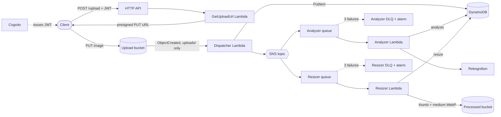

<!-- TODO: confirm the repo URL and the frontmatter field names your blog uses. -->

A signed-in user uploads a JPEG or PNG. The system records it, tags it with Amazon Rekognition, and makes a thumbnail and a medium-sized copy. That is the whole feature set, and it is deliberately small, because the point of this project is not the features. It is the shape: every step is an independent consumer of the same upload event, so adding a new step means adding a queue and a function, and nothing that exists changes.

This is the sixth version of a project that started as a plain "S3 triggers a Lambda" demo. The last version worked on the happy path and nothing else. This post is about making it behave on the unhappy path, and about proving the fan-out design by adding a second consumer that has nothing to do with Rekognition.

We use AWS SAM to declare everything in one template, and the functions are TypeScript on Node.js 20 (arm64), bundled by esbuild.

## Table of contents

1. What was wrong with the first version
2. The architecture
3. Uploading without touching Lambda
4. The dispatcher and the fan-out
5. Queues, retries and dead-letter queues
6. One item, one owner per attribute
7. The resizer, and the trigger loop that wasn't
8. Testing it
9. Results
10. Good to know
11. Next steps
12. How to run it

## 1. What was wrong with the first version

The first version took an image from S3, wrote a row to DynamoDB, published to SNS, and an analyzer Lambda called Rekognition. On a good day it was fine. Reading it back as if it had real users, I found this:

| Gap | Why it hurts |
| --- | --- |
| Handlers caught every error and only logged it | Lambda reports success, so nothing retries and nothing lands in a DLQ. A row stays `INITIALIZED` forever. |
| The client chose the S3 key | Two users uploading `photo.jpg` overwrite each other. |
| No limit on type or size | Rekognition only reads JPEG and PNG, so other files failed silently. |
| One shared `status` field, and an unconditional `PutItem` | A duplicate event could overwrite a finished item. |
| One consumer, wired straight to SNS | A bad message is retried a few times and then dropped. A second consumer would have no isolation from the first. |
| Hardcoded bucket and topic names | A second deploy collides, and the names are global. |

So the work was in five steps: a working test setup, making failures visible, safe uploads, queues between SNS and the consumers, and finally the resizer. Each step has a git tag, so the diff between two tags is the record of what changed.

## 2. The architecture




<!-- TODO: if your blog does not render Mermaid, export this diagram as an image. -->

The pieces, in the order a request flows:

1. **Cognito** handles sign-in and issues the JWT the API checks.
2. **API Gateway (HTTP API)** has one route, `POST /upload`, behind a JWT authorizer. It returns a presigned S3 URL.
3. **The upload bucket** receives the image straight from the client.
4. **The dispatcher Lambda** is triggered by S3 `ObjectCreated` for keys under `uploads/`. It writes the item to DynamoDB and publishes one message to SNS.
5. **SNS and SQS.** The topic fans the message out to one queue per consumer.
6. **The analyzer** reads its queue, asks Rekognition for up to five labels, and updates its part of the item.
7. **The resizer** reads its own queue, makes a 256 px thumbnail and a 1024 px medium copy in WebP, and writes them to a separate bucket.
8. **DynamoDB** holds one item per upload, keyed by the S3 key.

## 3. Uploading without touching Lambda

The client never sends image bytes through API Gateway or Lambda. It asks for an upload URL, then `PUT`s the file straight to S3.

```bash
curl -s -X POST "$API/upload" \
  -H "Authorization: Bearer $TOKEN" -H "Content-Type: application/json" \
  -d '{"filename":"photo.jpg","contentType":"image/jpeg","size":123456}'
# => 200 { "uploadUrl": "...", "key": "uploads/<sub>/<uuid>.jpg", "message": "..." }
```

Three rules make this safe, and each one fixes a gap from section 1:

- **The server chooses the key**: `uploads/{sub}/{uuid}.{ext}`, with `sub` from the JWT and `uuid` from `crypto.randomUUID()`. The filename is validated and never used, so users cannot overwrite each other.
- **Only `image/jpeg` and `image/png` up to 10 MB.** The extension must match the type. Anything else is a `400` that says which check failed, before a URL is signed.
- **The URL signs `Content-Type` and `Content-Length`**, so S3 rejects an upload that differs from what was declared. It expires after 5 minutes.

One detail is easy to miss. The presigner does not sign `content-type` unless you pass it in `signableHeaders`. By default only `content-length` and `host` are signed, so without that option S3 would happily accept any content type. A unit test now checks that the signed headers are `content-length;content-type;host`, and a live test confirms S3 answers `403` to a `PUT` with a different type or length.

## 4. The dispatcher and the fan-out

The dispatcher does two things: record the upload, and announce it. It starts each item with both consumers `PENDING`, and the write is conditional so a duplicate S3 event can never reset finished work:

```ts
await ddbDocClient.send(
    new PutCommand({
        TableName: tableName,
        Item: {
            id: fileKey,
            bucket: bucketName,
            size: record.s3.object.size,
            createdAt: new Date().toISOString(),
            analysis: { status: 'PENDING' },
            resize: { status: 'PENDING' },
        },
        ConditionExpression: 'attribute_not_exists(id)',
    }),
);
```

When the condition fails, the item already exists. That is either a duplicate event, or a retry after the publish below it failed. The dispatcher reads the item and publishes again only while a consumer is still `PENDING`. Without that check, a retry after a failed publish would see "already exists", skip the publish, and the event would be lost.

The dispatcher does not catch errors. If anything else goes wrong it throws, so S3 retries the invocation.

## 5. Queues, retries and dead-letter queues

In the first version the analyzer hung directly off SNS. A failed delivery was retried a few times and then dropped. Each consumer now has its own queue and DLQ.

```yaml
AnalyzerQueue:
  Type: AWS::SQS::Queue
  Properties:
    # 6x the analyzer's timeout (30 s), so a message isn't handed to a second invocation
    # while the first may still be working on it.
    VisibilityTimeout: 180
    RedrivePolicy:
      deadLetterTargetArn: !GetAtt AnalyzerDeadLetterQueue.Arn
      maxReceiveCount: 3

AnalyzerSubscription:
  Type: AWS::SNS::Subscription
  Properties:
    TopicArn: !Ref ImageEventsTopic
    Protocol: sqs
    Endpoint: !GetAtt AnalyzerQueue.Arn
    RawMessageDelivery: true
    FilterPolicy:
      eventType:
        - ObjectCreated
```

- A queue policy lets only this topic send to this queue.
- Raw message delivery means the consumer reads the dispatcher's JSON directly, with no SNS envelope.
- After 3 failed attempts a message moves to the DLQ, and a CloudWatch alarm on that DLQ goes to `ALARM`.
- Both consumers return a **partial batch response**, so one bad record is retried on its own and the rest of the batch does not run again:

```ts
for (const record of event.Records) {
    try {
        await processRecord(record);
    } catch (error) {
        console.error(`Record ${record.messageId} failed, returning it to the queue:`, error);
        batchItemFailures.push({ itemIdentifier: record.messageId });
    }
}
return { batchItemFailures };
```

There is one more rule, and it matters as much as the retries: **retrying cannot fix a file that can never be processed.** An image Rekognition cannot read, or one over 50 megapixels for the resizer, is recorded as `FAILED` and not retried. Only transient failures (S3, DynamoDB, throttling) are retried and can reach the DLQ.

The alarms do not notify anyone yet. They only change state. An email or chat target is a next step.

## 6. One item, one owner per attribute

Each consumer owns one attribute of the item and writes nothing else, so consumers never overwrite each other:

```json
{
  "id": "uploads/<sub>/<uuid>.jpg",
  "bucket": "darkroom-uploadbucket-...",
  "size": 123456,
  "createdAt": "2026-11-12T10:00:00.000Z",
  "analysis": { "status": "COMPLETE", "labels": ["Dog", "Grass"], "at": "..." },
  "resize": {
    "status": "COMPLETE",
    "variants": ["<sub>/<uuid>_thumb.webp", "<sub>/<uuid>_medium.webp"],
    "at": "..."
  }
}
```

| `status` | Meaning |
| --- | --- |
| `PENDING` | The consumer has not finished yet. |
| `COMPLETE` | Done. `analysis` has `labels`, `resize` has `variants`. |
| `FAILED` | The file can never be processed, so it was recorded instead of retried. |

The update is conditional on the item existing (`attribute_exists(id)`), so a consumer can never create an item that the dispatcher did not. A missing item fails the invocation and goes back to the queue.

## 7. The resizer, and the trigger loop that wasn't

The resizer is the proof that the design works. It subscribes to the same topic and touches nothing that exists. Adding it was a new queue, a DLQ, an alarm, a subscription, a function, and one change in the dispatcher: starting `resize` as `PENDING`.

Two things were worth getting right.

**No trigger loop.** A function that reads from a bucket and writes back to it can trigger itself. The resizer writes to a separate **processed bucket**, and the upload trigger is also filtered to the `uploads/` prefix. A live test uploads one image and checks that no item appears for either copy.

**`sharp` on arm64 Lambda.** `sharp` is native code, so esbuild cannot bundle it and SAM does not package externals. It ships as a Lambda layer. The layer's `.npmrc` sets `os=linux`, `cpu=arm64` and `libc=glibc`, so `npm install` fetches the Linux arm64 binaries even on a Mac. No Docker needed, and no fallback to a pure-JS library. The function bundle itself is 2 KB.

Resizing rules: fit inside the box, keep the aspect ratio, never upscale. A 3000×2000 image gives 256×171 and 1024×683. A 100×50 image stays 100×50. The resizer runs at 1024 MB with batch size 1, because image work is memory-heavy.

## 8. Testing it

Most of this project is events and queues rather than HTTP, so the tests assert on S3, DynamoDB, SQS and CloudWatch, not just on responses.

- **59 unit tests** with mocked AWS clients (`aws-sdk-client-mock`). The resizer tests run real `sharp`.
- **A fast live suite** (about a minute) against the deployed stack: the upload API, S3 limits, upload to labels and resized copies, duplicates, `FAILED`, consumer independence, the prefix filter.
- **A slow live suite** (about 25 minutes): a poison message is sent to each consumer and must reach its DLQ and raise its alarm.

## 9. Results

Measured on the deployed stack, not just in unit tests:

| Check | Result |
| --- | --- |
| Upload to `analysis: COMPLETE` | about 4 seconds |
| Resizing a 320×240 image | a 256×192 thumb and an unchanged 320×240 medium, both `image/webp` |
| Poison message in the analyzer queue | in the DLQ after 3 attempts, about 9.5 minutes |
| DLQ alarm | `ALARM` about 3 minutes after the message arrived |
| A 56-megapixel PNG | the resizer fails with `UnreadableImage` while the analysis still completes |
| `PUT` with a different content type or length | `403` from S3 |

The 56-megapixel test is the one I care about most. It is the independence claim, shown: one consumer fails and the other does not notice.

## 10. Good to know

- **The retry time is long.** The visibility timeout is 6× the function timeout, so a poison message takes about 9 minutes to reach the analyzer's DLQ and about 18 for the resizer's. That is the price of not handing a message to a second invocation while the first may still be running.
- **There is no read endpoint.** Results are checked in DynamoDB and S3 directly. A `GET /images/{id}` with presigned URLs is the next step.
- **Renaming a stack is a new stack.** The project was called _media-processor_ through V5. I renamed it to Darkroom while the stack held only test data, because a new name creates a new stack. Inside a template, logical IDs never change as a tidy-up: renaming the user pool, table or bucket would make CloudFormation replace them and lose data. The change set against the deployed stack for the template refactor was empty.
- **`sam local invoke` is not local.** The dispatcher it runs writes to the real table and publishes a real message. Point the event at an object that exists, or the consumers retry it and it ends up in the DLQs.
- **My own script lied once.** `scripts/try-it.sh` treated an item that did not exist yet as finished, and printed `Done.` without checking the result. I only noticed because I read the item and the bucket myself. It is fixed, but it is a reminder to check the outcome, not the exit message.

## 11. Next steps

- A `GET /images/{id}` endpoint returning the item with short-lived URLs for the copies.
- A content-moderation consumer (Rekognition `DetectModerationLabels`): a new queue and a new function, and nothing else changes.
- Notifications on the DLQ alarms.
- Captions and semantic search with Amazon Bedrock.
- A small frontend, CI/CD, and a dev/prod split.

## 12. How to run it

You need the AWS CLI with credentials that can create the stack, the SAM CLI, and Node.js 20 or later. Docker is not needed to build or deploy.

```bash
cd functions && npm install && cd ..
sam validate --lint
sam build
sam deploy
```

Then run the script with any JPEG or PNG. It signs in (creating a demo user on the first run), uploads the image, waits for both consumers and prints the result:

```bash
DARKROOM_PASSWORD='YOUR-PASSWORD' scripts/try-it.sh path/to/photo.jpg
```

A few seconds later the item is complete and both copies exist:

```bash
aws dynamodb get-item --table-name $TABLE --key "{\"id\":{\"S\":\"$KEY\"}}"
aws s3 ls "s3://$PROCESSED/" --recursive
```

Everything is pay-per-use, so an idle stack costs almost nothing. The fixed costs are S3 storage and two CloudWatch alarms. Each upload costs one Rekognition call and a few Lambda invocations. Check current prices before relying on this.

To tear it down, empty both buckets first (S3 will not delete a bucket that has objects), then delete the stack:

```bash
aws s3 rm "s3://UPLOAD_BUCKET" --recursive
aws s3 rm "s3://PROCESSED_BUCKET" --recursive
sam delete --stack-name darkroom
```
